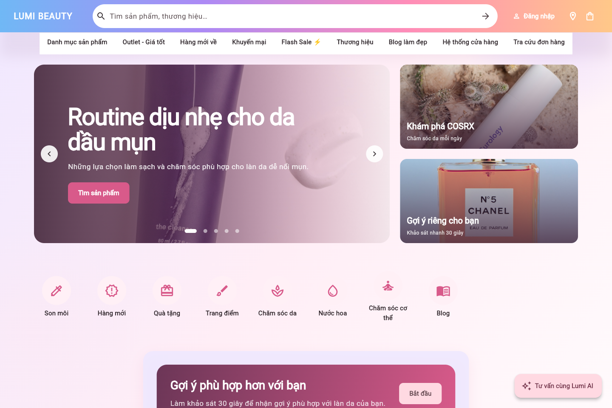
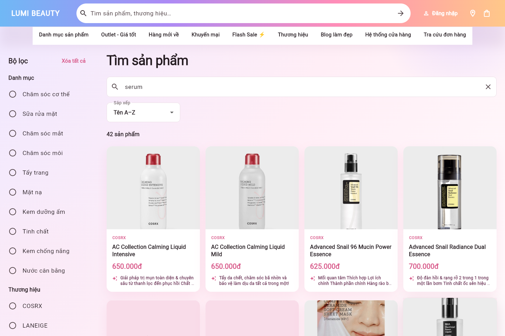
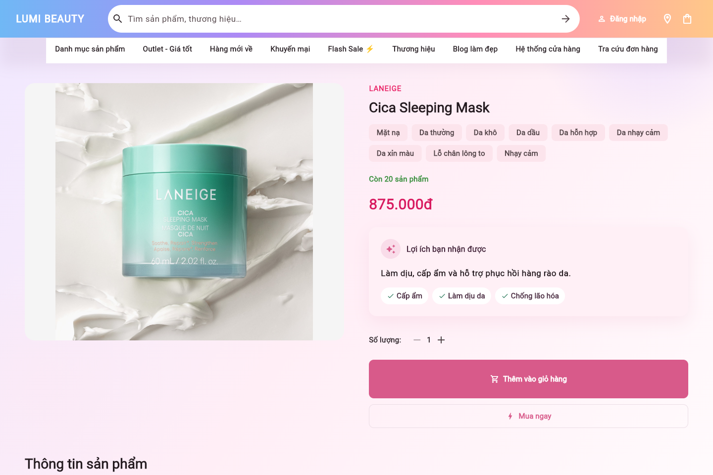
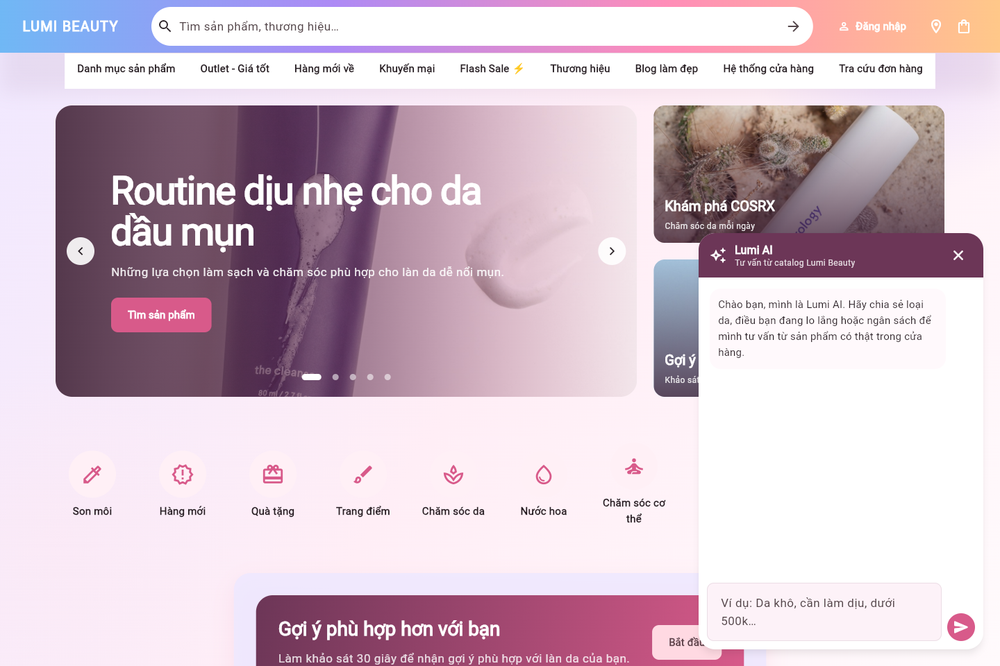

# Lumi Beauty — Nền tảng tư vấn & gợi ý mỹ phẩm

Lumi Beauty là đồ án cơ sở về thương mại mỹ phẩm có cá nhân hóa. Hệ thống kết hợp catalog MySQL, FastAPI, Flutter Web và recommendation engine để giúp người dùng tìm, hiểu và lựa chọn sản phẩm theo loại da, mối quan tâm, mục tiêu chăm sóc và ngân sách.

## Chức năng nổi bật

| Trang chủ & khám phá danh mục | Tìm kiếm và lọc theo dữ liệu thật |
| --- | --- |
|  |  |
| Hero carousel, danh mục điều hướng, gợi ý cá nhân hóa và lối vào tư vấn AI. | Tìm kiếm từ backend, lọc theo danh mục/thương hiệu và hiển thị giá VND đã chuẩn hóa. |

| Chi tiết sản phẩm có định hướng lợi ích | Lumi AI tư vấn theo catalog |
| --- | --- |
|  |  |
| Hiển thị tồn kho, giá, lợi ích chính, loại da phù hợp, số lượng và các CTA mua hàng. | Chat tiếng Việt, dùng dữ liệu sản phẩm đã xác minh; đề xuất bị ràng buộc bởi ngân sách, thành phần cần tránh và hồ sơ da. |

### Luồng trải nghiệm chính

```text
Đăng ký / đăng nhập
  → Khảo sát da & sở thích
  → Gợi ý cá nhân hóa
  → Tìm kiếm / lọc / xem chi tiết
  → Giỏ hàng / đặt đơn
  → Theo dõi trạng thái đơn hàng
```

## Current Scope

- Data crawling và lưu raw data bất biến.
- Cleaning, normalization, deduplication, validation và quality gate.
- Production-candidate catalog và AI-ready catalog là hai lớp riêng.
- MySQL schema/importer, behavior events và recommendation logs.
- Backend FastAPI cho health, readiness, behavior tracking và recommendation.
- JWT auth với mật khẩu PBKDF2-SHA256 và phân quyền CUSTOMER/ADMIN.
- Cart/checkout dùng giá phía server, kiểm tra tồn kho và lưu đơn hàng vào MySQL.
- Knowledge-Based Recommendation.
- Content-Based Recommendation bằng deterministic feature/Jaccard baseline.
- Hybrid ranking: Knowledge-Based + Content-Based.
- Cold start, similar products và recommendation explanation.
- Hard constraints tách khỏi ranking: ngân sách, currency, product exclusion và ingredient exclusion.
- Offline evaluation: Precision@K, Recall@K, HitRate@K, Coverage và Diversity.

## Intentional Architecture Decision

Collaborative Filtering hiện không có trọng số trong production scoring vì chưa có đủ interaction data thật để tạo user-item matrix đáng tin cậy. Hệ thống hiện dùng:

```text
FinalScore = alpha * KnowledgeBasedScore + beta * ContentBasedScore
CollaborativeFilteringWeight = 0
```

Đây là quyết định có chủ đích, không phải bug hay feature bị bỏ dở. Không dùng behavior giả, interaction random hoặc CF weight tùy ý.

## Future Extensions

- Collaborative Filtering khi có đủ view/click/favorite/cart/purchase/rating/feedback thật.
- Chatbot dựa trên dữ liệu đã kiểm duyệt.
- Stream analytics/Kafka khi traffic và nhu cầu nghiệp vụ đủ lớn.
- Real-time evaluation, online learning và production A/B testing.

Các thư mục placeholder cho chatbot/analytics/stream chỉ là future-ready boundary; endpoint tương ứng trong OpenAPI được gắn `PLANNED`.

## Data Pipeline

```text
crawl
  → raw data
  → source-preserving enrichment/clean
  → normalization
  → deduplication
  → validation
  → production candidate
  → AI-ready dataset
  → database
```

`Crawled successfully` không đồng nghĩa với `AI-ready`. Record thiếu dữ liệu được giữ cùng reason code; pipeline không tự bịa warning, contraindication, safety claim hoặc medical suitability.

Reason code chính:

- `MISSING_NAME`, `MISSING_BRAND`, `MISSING_CATEGORY`, `MISSING_SKU`
- `INVALID_PRICE`, `INVALID_CURRENCY`, `INVALID_SOURCE`
- `INSUFFICIENT_AI_FEATURES`, `DUPLICATE_PRODUCT`, `MALFORMED_PRODUCT`

Provenance phân biệt `FACTUAL`, `DERIVED`, `USER_GENERATED`; field suy ra từ phrase mapping được ghi `evidence_type=inferred` và confidence riêng. Validation time không được dùng giả làm verification time.

## Recommendation Flow

```text
User Profile
  → Candidate Generation
  → Hard Constraints / Safety Filter
  → Knowledge-Based Score
  → Content-Based Score
  → Hybrid Ranking
  → Explanation
```

Hard constraint trả `FILTERED_OUT` cùng reason code như `USER_EXCLUDED_INGREDIENT`, `OUTSIDE_BUDGET` hoặc `CURRENCY_MISMATCH`. Preferred brand/category vẫn là soft preference.

## API hiện đã triển khai

- `GET /health`
- `GET /ready`
- `POST /auth/register`
- `POST /auth/login`
- `GET /auth/profile`
- `GET /products`
- `GET /products/{productId}`
- `POST /orders`
- `GET /orders`
- `GET /admin/orders` (ADMIN)
- `GET /admin/dashboard` (ADMIN)
- `GET /admin/data-quality` (ADMIN)
- `GET|POST /admin/products` và `GET|PUT /admin/products/{productId}` (ADMIN)
- `PATCH /admin/products/{productId}/status|stock` (ADMIN)
- `GET /admin/inventory` (ADMIN)
- `GET /admin/orders/{orderId}` và `PATCH /admin/orders/{orderId}/status` (ADMIN)
- `GET /admin/users` và `GET /admin/users/{userId}` (ADMIN)
- `POST /behavior-events`
- `POST /recommendations/personalized`
- `GET /recommendations/similar-products/{productId}`
- `POST /recommendations/explain`
- `POST /chat` (Gemini, grounded bằng catalog và recommendation engine)

Contract: `contracts/openapi/system-api.yaml`.

## Chạy test

Python 3.12+, Flutter và dependencies trong `requirements-data-pipeline.txt` cùng `services/recommendation-service/requirements.txt`. Có thể đặt `PYTHON_BIN` và `FLUTTER_BIN` nếu hai executable chưa nằm trong `PATH`.

```powershell
./scripts/test.ps1
```

Lệnh trên chạy data-pipeline tests, backend tests, `flutter analyze` và Flutter widget/unit tests.

MySQL integration test là tùy chọn và không được chạy vào production DB. Integration flow mặc định dùng in-memory database deterministic.

## Offline evaluation

```powershell
Set-Location services/recommendation-service
python -m recommendation_service.evaluation_cli
```

Output:

- `datasets/reports/recommendation_evaluation_report.json`
- `datasets/reports/recommendation_evaluation_report.csv`

Fixture hiện tại là expert/developer-defined offline set, không phải production user ground truth và không chứng minh hiệu quả trên người dùng thật.

## Configuration

Copy `.env.example` thành `.env.local` cho môi trường local. Không commit credential. Khi có budget, API yêu cầu `budgetCurrency`; importer chỉ nhận record có currency hợp lệ.

## Lumi AI Cosmetic Consultant

Lumi AI chạy qua FastAPI; Flutter không nhận hoặc lưu Gemini API key. Backend
trích xuất ràng buộc từ câu hỏi tiếng Việt, kết hợp hồ sơ đăng nhập, lọc/xếp hạng
bằng recommendation engine rồi chỉ gửi các ứng viên đã xác minh sang Gemini. Mọi
`productId` do mô hình trả về đều được kiểm tra lại trước khi gửi sang giao diện.
Lumi AI còn trả kết quả có cấu trúc cho routine sáng/tối, cảnh báo an toàn,
thông tin còn thiếu và câu hỏi tiếp theo. Backend kiểm tra lại mọi sản phẩm trong
routine, đồng thời không cho tổng giá các sản phẩm được chọn vượt ngân sách đã nêu.
Nội dung hoạt chất chỉ được cảnh báo khi dữ liệu thành phần tương ứng có trong catalog.
Khi người dùng đổi sang một danh mục mới trong hội thoại (ví dụ từ chăm sóc da khô
sang mặt nạ), danh mục và ngân sách ở lượt mới được ưu tiên; hồ sơ/lịch sử chỉ dùng
để xếp hạng. Khi Gemini tạm quá tải, giao diện vẫn nhận các sản phẩm đã lọc từ catalog
và thông báo rõ phần diễn giải AI đang chậm.

Thêm vào `.env.local` (không commit):

```dotenv
GEMINI_API_KEY=your_gemini_api_key
GEMINI_MODEL=gemini-3.5-flash-lite
GEMINI_TIMEOUT_SECONDS=15
```

Chạy backend và web:

```powershell
python -m pip install -r services/recommendation-service/requirements.txt
powershell -ExecutionPolicy Bypass -File .\scripts\start_backend.ps1

Set-Location apps\web
flutter build web --release
Set-Location ..\..
python .\scripts\share_web.py --host 127.0.0.1 --port 8080 --backend-port 8001
```

Mở `http://127.0.0.1:8080/`, chọn **Tư vấn cùng Lumi AI**, rồi thử:
`Da tôi khô và nhạy cảm, cần routine sáng tối đơn giản để làm dịu và cấp ẩm. Tổng ngân sách 500k, tránh hương liệu. Hãy giải thích cách dùng và lưu ý khi kết hợp.`

## Triển khai cloud: Vercel + Railway

Mô hình production dùng **Vercel cho Flutter Web** và **Railway cho FastAPI +
MySQL**. Vercel phục vụ giao diện qua CDN; Railway lưu bền vững user, đơn hàng,
đánh giá, tồn kho, hành vi và thực thi Lumi AI. Vì vậy website vẫn hoạt động khi
máy phát triển tắt.

```text
Người dùng → https://<lumi-web>.vercel.app (Flutter Web)
                    │ HTTPS / API_BASE_URL
                    ▼
              https://<lumi-api>.up.railway.app (FastAPI)
                    │ Railway private network
                    ▼
                         Railway MySQL
```

Xem các bước deploy, biến môi trường và cách import dữ liệu local ở
[docs/deployment/vercel.md](docs/deployment/vercel.md). Không commit MySQL dump,
Gemini key, JWT secret hay `.env.local`.
